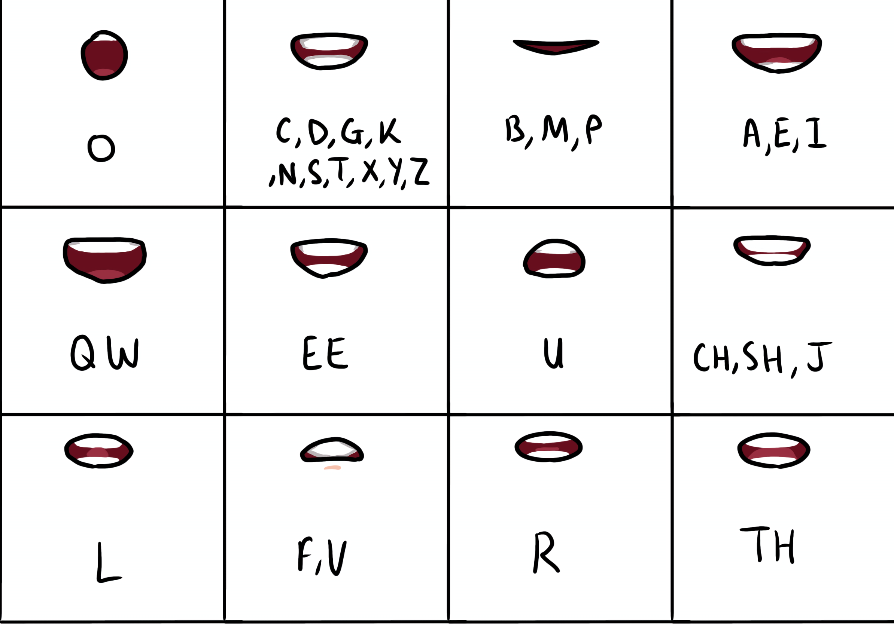

# POPPERS
An app to animate mouths from an input audio track.

## How to use
Place an mp3 file and (optionally) a transcript JSON in the Source folder.  
Esnure settings.json is correctly filled in.

The program will automatically follow this pipeline:  
- (If no JSON supplied) Call ElevenLabs to transcribe the file
- Convert words to ARPABET syllables
- Visualize it all with "Poppers"

## Custom images
This app allows the use of custom poppers and mouths.  
Ideally, all images should be 740x810 pixels but feel free to modify screen size to prevent overlap.
If you wish to use custom images, ensure they are in the correct folder, and are .png files.  
Mouths needs to contain exactly 13 files:
- 0 through 11.png
- silent_mouth.png

The files 0-11.png are based on the above reference sheet, enumerated from left to right, top to bottom.

## Dependencies
pygame  
syllabify  
elevenlabs  
dotenv

You will need an ElevenLabs API key in a .env file.